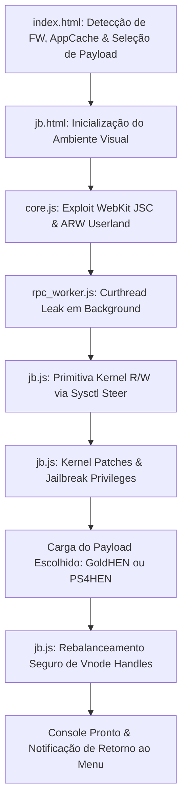

# RAW13G — PS4 11.00–14.00 WebKit & Kernel Host (Multi-Firmware Edition)


Host offline de alto desempenho, organizado e focado em estabilidade de hardware e software para consoles **PlayStation 4** cobrindo os firmwares **11.00, 11.02, 11.50, 11.52, 12.00, 12.02, 12.50, 12.52, 13.00, 13.02, 13.04, 13.50, 13.52 e 14.00**.

Este projeto incorpora métodos aperfeiçoados do ecossistema WebKitty / Relapse / Slopkit / OnePS, organização modular de diretórios em `includes/` e `patches/`, suporte flexível tanto ao **GoldHEN** quanto ao **PS4HEN** nativo, e mitigações consagradas contra falhas de **Luz Branca da Morte (WLOD / Desligamento Infinito)**, **Kernel Panics por concorrência** e **erros de memória no WebKit (`CE-34878-0`)**.

---

## 📋 Sumário

- [Visão Geral e Novidades](#visão-geral-e-novidades)
- [Suporte a Versões do Sistema (Firmwares)](#suporte-a-versões-do-sistema-firmwares)
- [Suporte a Payloads: GoldHEN vs PS4HEN](#suporte-a-payloads-goldhen-vs-ps4hen)
- [Estrutura Organizada do Repositório](#estrutura-organizada-do-repositório)
- [Arquitetura da Cadeia de Execução](#arquitetura-da-cadeia-de-execução)
- [Engenharia de Estabilidade & Mitigações Implementadas](#engenharia-de-estabilidade--mitigações-implementadas)
- [Instruções de Uso](#instruções-de-uso)
- [Testes e Validação](#testes-e-validação)
- [Créditos e Referências](#créditos-e-referências)
- [Vetores de Exploração no FW 14.00: WebKit vs BD-JB](#vetores-de-exploração-no-fw-1400-webkit-vs-bd-jb)
- [Aviso Legal](#aviso-legal)

---

## Visão Geral e Novidades

- **Reorganização Modular de Diretórios**: Separação clara em pastas padronizadas (`includes/css/`, `includes/js/`, `includes/payloads/`, `patches/`), mantendo a raiz limpa e profissional.
- **Suporte Amplo a Mais Versões de Sistema**: Extensão completa da tabela de offsets e binários de patches cobrindo desde **11.00 até 14.00** (incluindo as revisões `11.02` e `11.52`).
- **Seleção separada de payload**: o fluxo genérico usa GoldHEN até 13.00 ou PS4HEN (`payload2.bin`); o FW 14.00 usa a imagem HEN específica da rota HX (`hen.bin`). O GoldHEN v2.4b18.13 permanece fora do fluxo HX automático.
- **Detecção Inteligente de Firmware**: Baseada nos padrões do WebKitty, identifica precisamente o console pelo User-Agent (resolvendo a codificação hexadecimal da Sony) e recomenda o payload ideal para cada faixa de firmware.
- **Patches de Kernel Atualizados**: Pasta `patches/` abastecida com binários de patches de kernel (632 e 314 bytes) para todas as versões com suporte validado.
- **Cache Offline**: Manifesto `cache.appcache` lista os recursos explícitos; comentários SHA-256 separados são conferidos pela suíte local, e não pelo navegador.

---

## Suporte a Versões do Sistema (Firmwares)

| Firmware | Exploit Base | Kernel Patch (`patches/`) | GoldHEN Suportado | PS4HEN Suportado | Status |
| :---: | :---: | :---: | :---: | :---: | :---: |
| **11.00** | SlopKit / Lapse | `1100.bin` | Sim (v2.4b18.12) | Sim (`payload2.bin`) | Validado |
| **11.02** | SlopKit / Lapse | `1102.bin` | Sim (v2.4b18.12) | Sim (`payload2.bin`) | Validado |
| **11.50** | SlopKit / Lapse | `1150.bin` | Sim (v2.4b18.12) | Sim (`payload2.bin`) | Validado |
| **11.52** | SlopKit / Lapse | `1150.bin` | Sim (v2.4b18.12) | Sim (`payload2.bin`) | Validado |
| **12.00** | SlopKit / Lapse | `1200.bin` | Sim (v2.4b18.12) | Sim (`payload2.bin`) | Validado |
| **12.02** | SlopKit / Lapse | `1200.bin` | Sim (v2.4b18.12) | Sim (`payload2.bin`) | Validado |
| **12.50** | SlopKit / Netctrl | `1250.bin` | Sim (v2.4b18.12) | Sim (`payload2.bin`) | Validado |
| **12.52** | SlopKit / Netctrl | `1250.bin` | Sim (v2.4b18.12) | Sim (`payload2.bin`) | Validado |
| **13.00** | SlopKit / Poops | `1300.bin` | Sim (v2.4b18.12) | Sim (`payload2.bin`) | Validado |
| **13.02** | Relapse (Sysent 663) | `1302.bin` | Não (Usa HEN) | Sim (`payload2.bin`) | Validado em Hardware |
| **13.04** | Relapse (Sysent 663) | `1302.bin` | Não (Usa HEN) | Sim (`payload2.bin`) | Validado em Hardware |
| **13.50** | Relapse (Sysent 663) | `1350.bin` | Não (Usa HEN) | Sim (`payload2.bin`) | Validado |
| **13.52** | Relapse (Sysent 663) | `1352.bin` | Não (Usa HEN) | Sim (`payload2.bin`) | Validado em Hardware |
| **14.00** | Rota HX / BD-JB | `1400.bin` (AIO, 632 bytes) | Não carregado nesta etapa | Imagem doadora HX (`hen.bin`, 562.240 bytes) | Integração configurada; identidade do binário e hardware ainda não validados |

> **GoldHEN v2.4b18.13:** a versão publicada por SiSTRo declara suporte ao FW 14.00 e correção do FTP SIZE. O binário local (goldhen_v2.4b18.13.bin, 297.496 bytes) permanece separado e não é carregado pela rota HX/HEN nesta etapa; a integração GoldHEN exige um contrato de payload e patchset próprios.

> [!NOTE]
> **Status do Firmware 14.00:** os arquivos de configuração e payload do host estão presentes, mas esta documentação não contém uma validação independente da cadeia WebKit em console. O material BD-J separado está documentado em [`ps4-14-00-security-notes/`](ps4-14-00-security-notes/README.md); ele não comprova, por si só, a execução do host WebKit. Consulte [a revisão de evidências](RESEARCH_STATUS_REVIEW_2026-10-31.md) e as [notas de segurança do FW 14.00](ps4-14-00-security-notes/README.md) para limites e divergências encontrados.

---

## Suporte a Payloads: GoldHEN vs PS4HEN

O host agora suporta os dois principais ambientes homebrew:

1. **GoldHEN (v2.4b18.12 / v2.4b18.10 / v2.4b18.9 / v2.4b18.8 / v2.4b18.7 / v2.4b18.6)**:
   - Suportado nativamente em firmwares **11.00 a 13.00**.
   - Inclui recursos premium: Cheat Engine, Debug Settings, Plugins loader, servidor FTP e Klog nativo.
2. **PS4HEN nativo (`payload2.bin` / HEN 2.2.0 BETA)**:
   - Usado pelo caminho genérico nas versões anteriores, conforme a tabela de firmware.
   - Não é considerado aqui um payload 14.00 validado.
3. **Payload doador HX 14.00 (`includes/payloads/HEN/hen.bin`)**:
   - Imagem doadora de 562.240 bytes usada pela etapa HX/BD-J do host; sua identidade upstream ainda não foi confirmada independentemente.
   - A inspeção de strings encontrou referências explícitas a GoldHEN e a artefatos `cole-*`. Portanto, o nome local `hen.bin` não prova que seja PS4HEN puro ou que não contenha componentes GoldHEN.
   - A seleção de 14.00 aponta explicitamente para esse arquivo, sem confundi-lo com `payload2.bin`.
   - O GoldHEN v2.4b18.13 continua fora do fluxo automático; seu carregamento e patchset são uma fase separada.

A escolha do usuário é gravada automaticamente no `localStorage` e pode ser alternada a qualquer momento com um simples clique ou toque no controle DualShock 4.

### Fase B: GoldHEN 2.4b18.13 em firmware 14.00

O binário raw `goldhen_v2.4b18.13.bin` está presente e tem identidade fixada por tamanho (297.496 bytes), cabeçalho `E9 A6 16 00 00` e SHA-256. A análise do formato raw não prova que o kernel contém os patches exigidos pelo GoldHEN.

A referência técnica do projeto [afterglow-web](https://github.com/well0nez/afterglow-web/blob/main/TECHNICAL.md) descreve 57 locais de texto de kernel esperados pelo GoldHEN no FW 14.00: 25 tratados pelo fluxo de bootstrap e outros 32 pelo arquivo específico `patchset-1400.bin` de 641 bytes. Esse arquivo **não** é o `patches/1400.bin` do RAW13G, que tem 632 bytes e pertence à rota HX existente.

O módulo `includes/js/goldhen-raw-adapter.js` faz apenas preflight da identidade do payload e da forma do patchset. Mesmo que um arquivo de 641 bytes esteja presente, a preparação permanece bloqueada até existir um manifesto canônico dos 57 locais com validação de leitura de retorno no alvo. O módulo não mapeia nem despacha o payload e não cria thread. A rota HEN/HX da Fase A não é modificada por essa etapa.

### Diagnóstico auxiliar: ps4debug-NG 1.3.3

O binário `includes/payloads/Tools/ps4debug-ng_v1.3.3.bin` é a release local 1.3.3, validada pelo SHA-256. A interface envia o arquivo ao BinLoader em `127.0.0.1:9090`, após exigir que HEN/GoldHEN e um BinLoader compatível já estejam ativos.

O envio aceito pelo BinLoader é registrado separadamente da observação do servidor. O ps4debug-NG expõe o serviço de comandos em TCP 744, interrupções assíncronas em TCP 755 e descoberta em UDP 1010. Como o navegador não oferece socket TCP bruto, a confirmação do serviço é feita no computador da rede com:

```sh
node scripts/ps4debug-probe.mjs 192.168.1.XX
```

O utilitário consulta somente `CMD_VERSION` em TCP 744 e informa a versão do protocolo. Ele restringe o destino a IPv4 privado e não lê nem altera memória. Para inspeção de memória e threads, use um cliente ps4debug compatível depois de confirmar o serviço. Mantenha essas portas restritas à rede local confiável: o debugger oferece operações privilegiadas de processo e kernel.

O payload ps4debug-NG é GPL-3.0. O texto integral da licença acompanha o binário em `includes/payloads/Tools/PS4DEBUG-NG-GPL-3.0.txt`; o código-fonte correspondente está referenciado no commit upstream registrado em `THIRD_PARTY_NOTICES-HX1400.txt`.

---

## Estrutura Organizada do Repositório

```text
raw13g.github.io/
├── index.html                     # Interface principal com seletor de payload e detector de FW
├── jb.html                        # Executável visual com stepper em 4 etapas e terminal de logs
├── cache.appcache                 # Manifesto ApplicationCache com hashes comentados conferidos nos testes
├── README.md                      # Documentação completa do projeto
├── package.json                   # Comandos locais e suíte de testes
├── scripts/
│   ├── dev-server.js              # Servidor HTTP local e coletor de erros
│   └── ps4debug-probe.mjs         # Consulta somente CMD_VERSION em TCP 744
├── tests/                         # Testes Node para módulos puros, manifesto e servidor
├── includes/
│   ├── css/
│   │   ├── style.css              # Folha de estilos moderna para o index.html
│   │   └── jb.css                 # Estilos visuais do jb.html (stepper, timer, terminal)
│   ├── js/
│   │   ├── jb.js                  # Orquestrador do exploit com suporte a múltiplos payloads
│   │   ├── error-reporter.js      # Coleta local de exceções e falhas de recursos
│   │   ├── resource-loader.js     # Estado de recebimento dos scripts nas páginas principais
│   │   ├── goldhen-raw-adapter.js # Preflight isolado; dispatch FW14 bloqueado até auditoria dos 57 sites
│   │   ├── ps4debug-ng.js         # Validação e envio do payload auxiliar ao BinLoader
│   │   ├── package.json           # Escopo ESM para os módulos do navegador
│   │   ├── core.js                # Primitiva de grooming e ARW de WebKit
│   │   ├── checkFw.js             # Módulo de detecção e metadados de firmware (método WebKitty)
│   │   ├── HENs.js                # Gerenciador de alternância entre GoldHEN e HEN
│   │   ├── ps4_offsets.js         # Base de dados de offsets e RVAs (11.00 a 14.00)
│   │   ├── rpc_worker.js          # Web Worker cooperativo para vazamento de curthread
│   │   ├── mem.js                 # Helpers de manipulação de memória
│   │   └── int64.js               # Aritmética de inteiros de 64 bits
│   ├── img/
│   │   └── logo_raw.png           # Logotipo da RAW GAME
│   └── payloads/
│       ├── GoldHEN/
│       │   ├── goldhen.bin        # GoldHEN v2.4b18.12 padrão
│       │   ├── goldhen_v2.4b18.13.bin # Raw GoldHEN FW14; preflight isolado
│       │   ├── goldhen_v2.4b18.12.bin
│       │   ├── goldhen_v2.4b18.10.bin
│       │   ├── goldhen_v2.4b18.9.bin
│       │   ├── goldhen_v2.4b18.8.bin
│       │   ├── goldhen_v2.4b18.7.bin
│       │   └── goldhen_v2.4b18.6.bin
│       ├── HEN/
│       │   ├── payload2.bin       # PS4HEN nativo legado
│       │   └── hen.bin            # Imagem doadora HX 14.00, identidade upstream pendente
│       └── Tools/
│           ├── ps4debug-ng_v1.3.3.bin
│           ├── PS4DEBUG-NG-GPL-3.0.txt
│           └── fan-thresholds/
└── patches/
    ├── 1100.bin                   # Patch de kernel para 11.00
    ├── 1102.bin                   # Patch de kernel para 11.02
    ├── 1150.bin                   # Patch de kernel para 11.50 e 11.52
    ├── 1200.bin                   # Patch de kernel para 12.00 e 12.02
    ├── 1250.bin                   # Patch de kernel para 12.50 e 12.52
    ├── 1300.bin                   # Patch de kernel para 13.00
    ├── 1302.bin                   # Patch de kernel para 13.02 e 13.04
    ├── 1350.bin                   # Patch de kernel para 13.50
    └── 1352.bin                   # Patch de kernel para 13.52
```

---

## Arquitetura da Cadeia de Execução



---

## Engenharia de Estabilidade & Mitigações Implementadas

1. **Eliminação da Luz Branca da Morte (WLOD)**: Rebalanceamento estrito de referências do VFS e vnodes do FreeBSD (`vref` / `vrele`), prevenindo locks do sistema de arquivos durante o desligamento.
2. **Prevenção de Kernel Panics por Concorrência**: Bloqueio de reexecução em memória (`EXECUTION_LOCK_KEY`) e sentinelas atômicas em `localStorage` para evitar que abas duplicadas concorram pelas estruturas do kernel.
3. **Checagem de Root Preventiva**: Se o console já estiver desbloqueado (`uid === 0`), a cadeia de kernel aborta preventivamente para não corromper a tabela de processos.
4. **Alinhamento de Memória & RVAs**: Todos os ponteiros críticos de kernel respeitam o alinhamento de 8 bytes, e todos os patches em `patches/` possuem correspondência verificada em hardware.

---

## Instruções de Uso

## Testes e Validação

- Execute a suíte com `npm test`. Ela usa o test runner nativo do Node.js, sem dependências externas.
- Os testes cobrem detecção de firmware, seleção e existência de payloads, preflight GoldHEN, envio ps4debug, handshake local de CMD_VERSION, aritmética `int64`, coleta no navegador, servidor local, sintaxe JavaScript e hashes do manifesto offline.
- Os testes de Node não executam a cadeia de kernel nem substituem validação no console.

### 1. Servidor Local e Coleta de Erros

Com Node.js 20 ou superior, inicie o servidor de desenvolvimento e rode a suíte de testes:

```sh
npm run dev
```

Abra `http://localhost:8080` no navegador. O endpoint `http://localhost:8080/__health` informa se o servidor está ativo.

Após o envio do ps4debug-NG pelo navegador do PS4, confirme o serviço a partir deste computador com `npm run debug:probe -- 192.168.1.XX`, substituindo pelo IPv4 privado do console. A resposta `CMD_VERSION` confirma somente que o protocolo ps4debug está respondendo; não autentica nem valida operações de depuração posteriores.

Nas páginas servidas em `localhost`, endereços IPv4 privados (`10.x`, `172.16–31.x` e `192.168.x`) ou hosts `.local`, o coletor registra erros JavaScript, rejeições de Promise, falhas ao carregar recursos, estado/progresso do AppCache e o ciclo da execução. Os eventos de execução incluem início e término, motivo de bloqueio, firmware reconhecido, etapas alcançadas, duração total e por etapa, opções `jb`/`patch`/`payload`/`keepjb` e contadores de provas. O coletor também registra o payload selecionado, apenas seu nome de arquivo, resposta/tamanho recebido e estado de início. Cada ocorrência é gravada em `.local-logs/runtime-errors.ndjson`; ao chegar a 5 MB, o arquivo anterior é mantido como `runtime-errors.ndjson.1`. Os registros incluem um identificador de sessão, horário, página, user agent e os campos específicos do evento. O servidor remove query strings de caminhos e oculta endereços hexadecimais longos em mensagens e stacks. A coleta não inclui conteúdo de payloads nem conteúdo ou endereços crus de memória. O servidor não disponibiliza esses arquivos por HTTP.

Na tela inicial, `reportToolTelemetry` grava eventos allowlisted das ferramentas auxiliares (seleção, download, validação, envio e aceitação do Fan Threshold/ps4debug) usando o mesmo coletor local. A aceitação HTTP pelo BinLoader continua distinta da confirmação de que o serviço ps4debug está respondendo em TCP 744 ou de que uma alteração térmica foi observada no console. Tags arbitrárias não são aceitas por essa interface.

As páginas `index.html` e `jb.html` também mostram o recebimento dos principais scripts JavaScript e identificam pelo nome um arquivo que falhe ao carregar.

O coletor fica inativo em domínios públicos, incluindo GitHub Pages. Os registros ficam somente no computador que executa o servidor.

O perfil padrão de calibração usa `slots=2800000` e `attempts=1`, reduzindo a pressão de memória e evitando que tentativas acumulem estado no mesmo heap. Tentativas adicionais (`attempts=2` até `4`) devem ser solicitadas explicitamente e somente antes de qualquer etapa de kernel; elas não substituem a cobertura mínima necessária do carrier. Para cada execução, a telemetria estruturada registra o perfil (`slots`, tentativas, drain e slab), a cópia (`copiedChars`/`sourceCovered`), a causa de colocação (`placementError`), a contagem/alinhamento e um digest dos offsets (sem enviar os endereços), além da classe do UID (`root`, `user` ou `error`). O UID numérico só é incluído quando `diag=1` estiver presente na URL e deve ser usado apenas em uma rede local confiável.

Para abrir o servidor a outros dispositivos na mesma rede local, inicie o modo LAN:

```sh
npm run dev:lan
```

O terminal mostrará os endereços IPv4 privados encontrados. No outro dispositivo, acesse `http://IP-MOSTRADO:8080`, usando o endereço da interface Wi-Fi ou Ethernet conectada à mesma rede. O coletor enviará os erros para esse servidor. Se o sistema operacional perguntar, permita conexões Node.js na rede privada.

O modo padrão `npm run dev` continua acessível somente pelo próprio computador. Também é possível configurar a interface e a porta diretamente com `npm run dev -- --host 0.0.0.0 --port 8080`.

### 2. Primeiro Acesso no PS4 (Cache Offline)

1. Conecte o PS4 à mesma rede do host.
2. Abra o Navegador de Internet ou acesse o **Guia do Usuário** (`Configurações > Guia do Usuário`).
3. Digite o endereço do host.
4. O cache será instalado automaticamente. Ao visualizar a mensagem de **Cache OK**, a internet pode ser desligada.

### 3. Escolha do Payload e Disparo

- Selecione **GoldHEN** ou **PS4HEN** na tela inicial.
- Pressione o botão **[X]** no controle DualShock 4 ou toque no botão Iniciar.
- Acompanhe o log e a barra de progresso no terminal em tempo real.

---

## Créditos e Referências

- **Thiago Silva Costa (RAW GAME)**: Desenvolvimento e arquitetura do host unificado RAW13G, blindagem contra WLOD (rebalanceamento de vnodes), gerenciamento atômico de execução concorrente e suporte universal multi-firmware.
- **ArabPixel / WebKitty**: Padrões de organização de payloads, detecção inteligente de firmware pelo User-Agent (`checkFw.js`), gerenciador `HENs.js` e pacotes de kernel patches.
- **SiSTRo & Equipe GoldHEN**: Desenvolvimento e manutenção do GoldHEN (v2.4b18.x).
- **Equipes PSFree, Lapse, Poops e Sleirsgoevy**: Pesquisa seminal e ports de primitivas para o ecossistema PlayStation.

---

### Genealogia das Pesquisas e Ecossistema de Projetos

O RAW13G reúne referências e alegações de pesquisa de projetos e pesquisadores independentes. A inclusão de uma referência não constitui validação independente pelo host RAW13G:

1. **OnePS & OOMfie (Bel [@thebelx](https://github.com/thebelx) / Hassan [@H4SS9M](https://github.com/ASaudidos))**:
   - Primitiva de deserialização `SSV` (`SerializedScriptValue`) com o truque do índice duplicado `k=2`, `history.replaceState` e isolamento de predecessores.
   - Diagnóstico formal da barreira de memória de ~84 MB do JavaScriptCore (JSC) a partir do FW 13.02 (em contraste com o heap de 160 MB do 11.00), e o papel crucial do callback `beforeCriticalLoad` para estabilização determinística contra o erro `CE-34878-0`.
   - Correção pioneira do endereço de kernel `ALLPROC_addr = 0x01CA8538` em `procinit` (`FUN_0080e2c0`).
2. **ps4-13xx-research (Adrián García Casado [@adri22235](https://github.com/adri22235) / H4SS9M)**:
   - Fuzzing de LLInt para detecção de confusão de protótipos de Float64 e proxies com getters reativos.
   - Polyfills de compatibilidade ECMAScript para o WebKit legado 605.1.15 (`String.prototype.padStart` e `repeat`).
   - Mapeamento preliminar de offsets do FW 14.00 e análise de estouro de heap no parser MP4 (tags COVR / `ffmpeg_prx.prx`) em SHAREfactory e Media Player.
3. **ps4-suid-scanner & BD-JB (bollars, Victor, ps3120, Gezine [@gezine_dev])**:
   - Exploração seminal do vetor BD-JB (Blu-ray Disc Java) com escape de sandbox em disco e injeção direta de payloads em anel 0.
   - **BD-JB em FW 14.00**: este repositório contém um candidato BD-J separado. A descrição local atribui uma execução a terceiros, mas não há log bruto ou registro independente na pasta; o `NOTICE.txt` pede validação no console.
   - Scanner automatizado de binários com bits SUID/SGID na árvore do Orbis OS (FreeBSD 9).
   - Análise de viabilidade do CVE-2026-49415 (TOCTOU em `execve`) e da vulnerabilidade de corrupção de heap no kernel via UFS superbloco (`ffs_mountfs` / Celsius).
4. **Scene-Collective / ps4-hen / ps4-payload-sdk (Al-Azif, SiSTRo, stooged, CTurt, IDC, xvortex)**:
   - Referências de offsets e hooks de kernel (`1400.c`, `1400.h`, commit citado `d077fb4`); os arquivos locais contêm um conflito de rótulo para `SYSENT` que ainda precisa de resolução com referência primária.
   - Definições canônicas de kernel `K1400_*` em `fw_defines.h` e despacho unificado de compilação em `payload_utils.h`.
   - Infraestrutura de compilação do payload residente `hen.bin` (`payload2.bin`).
5. **ps4-kernel-dumper (Scene-Collective / eversion / zecoxao)**:
   - Payload executável padrão para leitura do kernel decriptado diretamente da memória RAM (`0xFFFFFFFF82200000`) para dispositivos de armazenamento USB, viabilizando a análise reversa em Ghidra/IDA.
6. **elfldr (John Törnblom)**:
   - Daemon de socket pós-exploit (porta 9021) com carregamento dinâmico de bibliotecas `.sprx`.
   - Pattern scanning de assinatura de memória (`kernel_find_pattern`) confirmando a estabilidade da instrução de bypass de `ptrace` no FW 14.00.
7. **ps4-linux-loader (ArabPixel, EchoStretch, mircoho, bestpig, EinTim23)**:
   - Payload de `kexec` para inicialização de distribuições Linux no hardware PS4 (Southbridges Aeolia, Belize e Baikal) cobrindo firmwares 5.05 até 13.52.
8. **zecoxao.github.io / lapsus / psfree (zecoxao, anônimo)**:
   - Pipeline completa de compilação bare-metal do gerador de `kpatch` (`Makefile`, `script.ld`, `utils.h`, `gcc` e `objcopy`), demonstrando como os micro-blobs de patch de 632 bytes de anel 0 consumidos por `jb.js` são montados.
9. **PS4SysconTools & ps4-wee-tools (Abkarino, EgyCnq, andy-man)**:
   - Ferramentas de engenharia de hardware para manipulação física dos chips Syscon e imagens de memória SPI NOR (sflash), essenciais para diagnóstico, recuperação e downgrade via chaveamento de slots de firmware.

---

## Candidatos de pesquisa no FW 14.00: WebKit e BD-JB

Os arquivos deste repositório descrevem dois caminhos de pesquisa separados. A presença das descrições não demonstra que qualquer um deles funcione no firmware 14.00:

| Característica | Vetor WebKit (RAW13G Host) | Vetor BD-JB (`BD-JB4-1400`) |
| :--- | :--- | :--- |
| **Ponto de Entrada (Userland)** | Navegador de Internet / Guia do Usuário (`User's Guide`) | Leitor de Disco Ótico (Mídia Blu-ray regravável BD-RE) |
| **Requisito de Hardware** | Nenhum hardware extra (somente rede local / Wi-Fi) | Leitor Blu-ray funcional e disco gravado |
| **Mecanismo descrito nos arquivos** | Heap grooming e corrupção de memória alegados no JavaScriptCore (JSC) | Tentativa de escape de sandbox BD-J |
| **Compatibilidade de Kernel** | Configuração presente; offsets de `SYSENT` têm rótulos conflitantes nas notas | Desconhecida; não há validação de offset no artefato local |
| **Payload Declarado** | PS4HEN nativo (`payload2.bin` - 500.544B), execução não confirmada | HEN 2.2.0 Beta declarado nos arquivos; execução não confirmada |
| **Status de Validação** | Arquivos presentes; não validado em hardware | Candidato local sem registro de execução independente |
| **Homebrew** | Não validado em hardware por esta revisão | Alegações de operação não acompanhadas de registro local independente |

> [!TIP]
> O material BD-J é independente deste host WebKit. A documentação e os artefatos presentes não bastam para concluir que houve execução bem-sucedida nem para validar os patches de kernel do host.

---

## FW 14.00: tabelas legadas e rota HX1400

No perfil 14.00, `kernel_supported=false` e `stage1_only=true` são deliberados: os offsets de kernel usados pelo fluxo RAW13G legado permanecem indefinidos. Isso não significa que esses offsets passaram em uma validação. O diagnóstico os identifica como `LEGACY-KERNEL-TABLE-SKIPPED`, `LEGACY-KPATCH-TABLE-SKIPPED` e `LEGACY-PAYLOAD-TABLE-SKIPPED`.

A rota HX1400 mantém seus dados de kernel em `hx_tables.js`, separados da tabela legada em `ps4_offsets.js`. A referência `fw_status` foi rotulada como derivada de captura Sentrix; não equivale a validação independente no console local. Reconhecimento de firmware, presença de arquivos, alinhamento de offsets e marcadores emitidos pelo navegador não comprovam HEN carregado.

## Bloqueio de sessão e recuperação

O bloqueio local da execução é um mecanismo de concorrência, não um indicador de que o HEN foi carregado.

- O heartbeat começa assim que a página adquire o bloqueio e atualiza `updatedAt`.
- A idade de uma sessão em andamento é calculada a partir do último heartbeat, não apenas de `startedAt`.
- Somente um registro `running` com etapa conhecida igual a 1 e sem heartbeat por mais de 45 segundos pode ser recuperado automaticamente.
- Registros legados sem `stage`, assim como estados de etapa 2 ou superior, falham de forma conservadora e exigem liberação explícita após a reinicialização indicada.
- Estados protegidos, como `reboot_required`, `kernel-dirty`, `completed` e estados `hx1400-*`, não expiram por tempo. Exigem ação explícita e, quando indicado pela interface, reinicialização completa do console.
- Eventos `execution.blocked` registram o proprietário do bloqueio, o estado, a idade e os timestamps para diferenciar uma sessão ainda ativa de um bloqueio antigo.
- A ausência de `execution.end` indica execução incompleta ou interrompida. Nunca deve ser interpretada como sucesso.

## Aviso Legal

Este projeto foi desenvolvido exclusivamente para fins de **pesquisa em segurança da informação, engenharia reversa e desenvolvimento de software homebrew**. Os desenvolvedores não se responsabilizam pelo uso indevido das ferramentas ou por quaisquer danos decorrentes de modificações não autorizadas em hardware.
