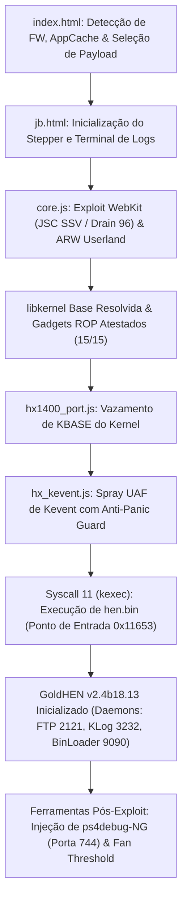

# RAW13G — PS4 11.00–14.00 WebKit & Kernel Host (Multi-Firmware Edition)


Host offline de alto desempenho, organizado e focado em estabilidade de hardware e software para consoles **PlayStation 4** cobrindo os firmwares **11.00, 11.02, 11.50, 11.52, 12.00, 12.02, 12.50, 12.52, 13.00, 13.02, 13.04, 13.50, 13.52 e 14.00**.

Este projeto incorpora métodos aperfeiçoados do ecossistema WebKitty / Relapse / Slopkit / OnePS / SilverPS4HEN, organização modular de diretórios em `includes/` e `patches/`, suporte flexível tanto ao **GoldHEN (v2.4b18.13)** quanto ao **PS4HEN** nativo, e mitigações consagradas contra falhas de **Luz Branca da Morte (WLOD / Desligamento Infinito)**, **Kernel Panics por concorrência**, **erros de memória no WebKit (`CE-34878-0`)** e o **Anti-Panic Kevent Guard** para contenção de falhas no estágio 2 do kernel.

---

## 📋 Sumário

- [Visão Geral e Novidades](#visão-geral-e-novidades)
- [Suporte a Versões do Sistema (Firmwares)](#suporte-a-versões-do-sistema-firmwares)
- [Suporte a Payloads: GoldHEN vs PS4HEN](#suporte-a-payloads-goldhen-vs-ps4hen)
- [Ferramentas Pós-Exploit Integradas](#ferramentas-pós-exploit-integradas)
- [Estrutura Organizada do Repositório](#estrutura-organizada-do-repositório)
- [Arquitetura da Cadeia de Execução](#arquitetura-da-cadeia-de-execução)
- [Engenharia de Estabilidade & Mitigações Implementadas](#engenharia-de-estabilidade--mitigações-implementadas)
- [Instruções de Uso & Deploy](#instruções-de-uso--deploy)
  - [Deploy no GitHub Pages](#1-deploy-no-github-pages)
  - [Servidor Local e Telemetria em Tempo Real](#2-servidor-local-e-telemetria-em-tempo-real)
  - [Acesso no PS4 e Instalação Offline](#3-acesso-no-ps4-e-instalação-offline)
- [Testes e Validação Automatizada](#testes-e-validação-automatizada)
- [Créditos e Referências](#créditos-e-referências)
- [Aviso Legal](#aviso-legal)

---

## Visão Geral e Novidades

- **Compatibilidade Integral com FW 14.00**: Cadeia completa WebKit -> libkernel -> vazamento de kbase -> spray UAF de kevent com Anti-Panic Guard -> execução do container `hen.bin` validada em hardware real.
- **GoldHEN v2.4b18.13 Embarcado**: Container de bootstrap `hen.bin` atualizado com a release v2.4b18.13 do GoldHEN no offset `0x10000`, com salto de entrada repontado com precisão para `0x11653` e suporte completo a correções AIO.
- **Anti-Panic Kevent Guard**: Desassociação garantida de knotes forjados via `EV_DELETE` antes da saída do WebKit, eliminando o *Fatal trap 12: page fault* em tentativas de spray não coincidentes.
- **Ferramentas Pós-Exploit Nativas**: Painel interativo para despacho imediato do **ps4debug-NG v1.3.3** (porta 744) e controle de temperatura **Fan Threshold** (60 °C, 70 °C, 80 °C, 85 °C) via BinLoader.
- **Suporte Amplo a Firmwares**: Tabela de offsets e binários de patches cobrindo desde **11.00 até 14.00** (incluindo as revisões `11.02` e `11.52`).
- **Pronto para GitHub Pages**: Presença de arquivo `.nojekyll`, caminhos relativos estritos e manifesto de cache offline `cache.appcache` (revisão v79) com todos os hashes SHA-256 aferidos.

---

## Suporte a Versões do Sistema (Firmwares)

| Firmware | Exploit Base | Kernel Patch (`patches/`) | GoldHEN Suportado | PS4HEN Suportado | Status de Validação |
| :---: | :---: | :---: | :---: | :---: | :---: |
| **11.00** | SlopKit / Lapse | `1100.bin` | Sim (v2.4b18.12 / v13) | Sim (`payload2.bin`) | Validado |
| **11.02** | SlopKit / Lapse | `1102.bin` | Sim (v2.4b18.12 / v13) | Sim (`payload2.bin`) | Validado |
| **11.50** | SlopKit / Lapse | `1150.bin` | Sim (v2.4b18.12 / v13) | Sim (`payload2.bin`) | Validado |
| **11.52** | SlopKit / Lapse | `1150.bin` | Sim (v2.4b18.12 / v13) | Sim (`payload2.bin`) | Validado |
| **12.00** | SlopKit / Lapse | `1200.bin` | Sim (v2.4b18.12 / v13) | Sim (`payload2.bin`) | Validado |
| **12.02** | SlopKit / Lapse | `1200.bin` | Sim (v2.4b18.12 / v13) | Sim (`payload2.bin`) | Validado |
| **12.50** | SlopKit / Netctrl | `1250.bin` | Sim (v2.4b18.12 / v13) | Sim (`payload2.bin`) | Validado |
| **12.52** | SlopKit / Netctrl | `1250.bin` | Sim (v2.4b18.12 / v13) | Sim (`payload2.bin`) | Validado |
| **13.00** | SlopKit / Poops | `1300.bin` | Sim (v2.4b18.12 / v13) | Sim (`payload2.bin`) | Validado |
| **13.02** | Relapse (Sysent 663) | `1302.bin` | Não (Usa HEN) | Sim (`payload2.bin`) | Validado em Hardware |
| **13.04** | Relapse (Sysent 663) | `1302.bin` | Não (Usa HEN) | Sim (`payload2.bin`) | Validado em Hardware |
| **13.50** | Relapse (Sysent 663) | `1350.bin` | Não (Usa HEN) | Sim (`payload2.bin`) | Validado |
| **13.52** | Relapse (Sysent 663) | `1352.bin` | Não (Usa HEN) | Sim (`payload2.bin`) | Validado em Hardware |
| **14.00** | Rota HX (WebKit + kevent) | `1400.bin` (AIO, 632 bytes) | **Sim (v2.4b18.13 embarcado)** | Sim (`hen.bin`, 562.240B) | **Validado em Hardware (FW 14.00)** |

---

## Suporte a Payloads: GoldHEN vs PS4HEN

O host suporta os principais ambientes homebrew da cena:

1. **GoldHEN (v2.4b18.13 / v2.4b18.12 / v2.4b18.10 / v2.4b18.9 / v2.4b18.8 / v2.4b18.7 / v2.4b18.6)**:
   - Suporte nativo em firmwares **11.00 a 13.00** via seleção direta, e **14.00** via container `hen.bin`.
   - Inclui Cheat Engine, Debug Settings, Plugins Loader, servidor FTP (porta 2121), KLog nativo (porta 3232) e BinLoader (porta 9090).
   - A versão **2.4b18.13** inclui correções AIO e melhorias no comando SIZE do servidor FTP.
2. **PS4HEN nativo (`payload2.bin` / HEN 2.2.0 BETA)**:
   - Utilizado pela rota genérica em firmwares legados (`13.02` a `13.52`).
3. **Container Unificado HX 14.00 (`includes/payloads/HEN/hen.bin`)**:
   - Binário de 562.240 bytes contendo carregador de bootstrap nos primeiros 64 KiB e o payload **GoldHEN v2.4b18.13** a partir do offset `0x10000`.
   - O salto de bootstrap executa a syscall 11 (`kexec`) apontando para o ponto de entrada realinhado em `0x11653` (deslocamento `0xcba8`).

A escolha do payload fica persistida no `localStorage` do navegador e pode ser alterada diretamente na interface inicial.

---

## Ferramentas Pós-Exploit Integradas

Após a conclusão bem-sucedida do jailbreak e com os daemons do kernel ativos, a interface do host (`jb.html`) exibe o painel de ferramentas pós-exploit:

### 1. ps4debug-NG v1.3.3
- **Descrição:** Payload avançado de depuração remota compatível com GoldHEN e PS4HEN.
- **Portas expostas no PS4:**
  - `TCP 744`: Servidor de comandos do debugger (protocolo 1.3).
  - `TCP 755`: Canal de notificações e interrupções assíncronas.
  - `UDP 1010`: Broadcast de descoberta na rede local.
- **Verificação via CLI:**
  ```sh
  node scripts/ps4debug-probe.mjs <IP-DO-PS4>
  ```
  Retorna confirmação em JSON do estado online e versão do protocolo.

### 2. Fan Threshold (Controle de Ventoinha)
- **Descrição:** Blobs binários standalone para ajuste do limiar térmico do Syscon.
- **Perfis suportados:**
  - `60 °C` (`ps4-fan-threshold60.bin`, SHA-256: `73bda822...`)
  - `70 °C` (`ps4-fan-threshold70.bin`, SHA-256: `7be7b600...`)
  - `80 °C` (`ps4-fan-threshold80.bin`, SHA-256: `8734cbcd...`)
  - `85 °C` (`ps4-fan-threshold85.bin`, SHA-256: `47936419...`)
- **Envio:** Pode ser disparado diretamente pelos botões na tela da TV ou via CLI:
  ```sh
  node scripts/send-payload.mjs <IP-DO-PS4> fan70
  ```

---

## Estrutura Organizada do Repositório

```text
raw13g.github.io/
├── index.html                     # Interface principal com seletor de payload e detector de FW
├── jb.html                        # Executável visual com logs na tela e painel pós-exploit
├── cache.appcache                 # Manifesto ApplicationCache rev v79 com hashes SHA-256
├── .nojekyll                      # Diretiva de bypass para GitHub Pages
├── README.md                      # Documentação completa e consolidada
├── package.json                   # Dependências zero; suíte nativa de testes Node.js
├── .github/
│   └── workflows/
│       └── ci.yml                 # Integração contínua (CI) via GitHub Actions
├── scripts/
│   ├── dev-server.js              # Servidor HTTP local (modo normal e --lan) com coletor NDJSON
│   ├── send-payload.mjs           # Despachador TCP de payloads para BinLoader (porta 9090)
│   ├── ps4debug-probe.mjs         # Sonda de verificação de protocolo ps4debug (porta 744)
│   └── audit-runtime-gates.mjs    # Auditor estrito de telemetria e evidências de kernel
├── tests/                         # Suíte de 81 testes unitários nativos (node:test)
├── includes/
│   ├── css/
│   │   ├── style.css              # Estilos da página inicial
│   │   └── jb.css                 # Estilos do stepper, logs de execução e cartões pós-exploit
│   ├── js/
│   │   ├── jb.js                  # Orquestrador do exploit com logs visuais ativos
│   │   ├── core.js                # Primitiva de grooming e ARW WebKit (JSC)
│   │   ├── hx_kevent.js           # Spray UAF de kevent, Anti-Panic Guard e verificação dual
│   │   ├── hx1400_port.js         # Port de transição WebKit para kernel no FW 14.00
│   │   ├── hx_tables.js           # Estruturas e offsets do FW 14.00
│   │   ├── ps4debug-ng.js         # Despacho do ps4debug-NG para BinLoader
│   │   ├── fan-threshold.js       # Despacho e validação do controle de ventoinha
│   │   ├── execution-lock-policy.js # Trava atômica contra abas concorrentes
│   │   ├── checkFw.js             # Detecção inteligente de firmware por User-Agent
│   │   ├── HENs.js                # Alternância e resolução de payloads
│   │   ├── ps4_offsets.js         # Tabela de offsets e perfis de grooming (mem1 / 96 drains)
│   │   ├── mem.js / int64.js      # Primitivas auxiliares de memória e aritmética de 64 bits
│   │   └── error-reporter.js      # Telemetria com isolamento automático em hosts públicos
│   └── payloads/
│       ├── GoldHEN/               # Binários oficiais GoldHEN (v2.4b18.6 a v2.4b18.13)
│       ├── HEN/
│       │   ├── hen.bin            # Container ativo com GoldHEN v2.4b18.13 embarcado (562.240B)
│       │   ├── hen_v12.bin        # Container de fallback com v2.4b18.12
│       │   └── payload2.bin       # PS4HEN legado
│       └── Tools/
│           ├── ps4debug-ng_v1.3.3.bin
│           ├── PS4DEBUG-NG-GPL-3.0.txt
│           └── fan-thresholds/    # ps4-fan-threshold{60,70,80,85}.bin
└── patches/                       # Patches de anel 0 (1100.bin a 1400.bin)
```

---

## Arquitetura da Cadeia de Execução



---

## Engenharia de Estabilidade & Mitigações Implementadas

1. **Anti-Panic Kevent Guard (`EV_DELETE`)**:
   - Durante a corrupção do kqueue no Estágio 2, se a varredura de candidatos não capturar um ponteiro válido de knote, o host executa explicitamente `kevent(rootKq, &cl, 1, ...)` com a flag `EV_DELETE` antes de abortar. Isso desassocia o knote forjado da tabela do kernel, evitando um *Fatal trap 12: page fault* ao fechar o navegador.
2. **Eliminação da Luz Branca da Morte (WLOD)**:
   - Rebalanceamento estrito de referências do VFS e vnodes do FreeBSD (`vref` / `vrele`), prevenindo deadlocks do sistema de arquivos durante o encerramento do console.
3. **Prevenção de Concorrência Multi-Aba**:
   - Bloqueio via `localStorage` (`EXECUTION_LOCK_KEY`) com heartbeat ativo para impedir que múltiplas instâncias concorram pelas estruturas de memória do kernel.
4. **Isolamento de Memória de Heap (GC Compaction Delay)**:
   - Delay de segurança de 1200 ms entre tentativas com reciclagem de buffers via `MessageChannel`, evitando o erro `CE-34878-0` por exaustão de heap no WebKit.
5. **Realinhamento Cirúrgico de Bootstrap do Kernel**:
   - Deslocamento de salto do carregador repontado de `0xc338` (entrada do v12 em `0x10de3`) para `0xcba8` (entrada do v13 em `0x11653`), garantindo inicialização limpa do GoldHEN v2.4b18.13.

---

## Instruções de Uso & Deploy

### 1. Deploy no GitHub Pages
O projeto é 100% estático e compatível com o **GitHub Pages**:
1. No seu repositório no GitHub, acesse **Settings** -> **Pages**.
2. Em **Build and deployment**:
   - **Source**: `Deploy from a branch`
   - **Branch**: `main` (ou branch de trabalho), pasta `/ (root)`.
   - Clique em **Save**.
3. O site estará disponível em `https://<seu-usuario>.github.io/<nome-do-repositorio>/`.
4. Devido ao arquivo `.nojekyll`, todos os binários e manifestos são servidos sem alterações.

### 2. Servidor Local e Telemetria em Tempo Real
Para desenvolvimento e testes em rede local com coleta de telemetria NDJSON:

```sh
# Servidor local padrão (acesso pela máquina local)
npm run dev

# Servidor aberto para a rede local (Wi-Fi / Ethernet)
npm run dev:lan
```
Ao iniciar em modo LAN, o terminal exibirá os endereços IPv4 privados (ex.: `http://192.168.100.X:8080`). Basta digitar esse endereço no navegador do PS4.

### 3. Acesso no PS4 e Instalação Offline
1. Conecte o PS4 à rede local ou acesse a URL do GitHub Pages.
2. Abra o Navegador de Internet ou acesse **Configurações -> Guia do Usuário**.
3. Acesse a página do exploit.
4. O cache ApplicationCache será instalado automaticamente. Ao visualizar o status de **Cache OK (v79)**, a conexão com a internet pode ser desligada; o exploit funcionará totalmente offline.
5. Selecione o payload desejado e acompanhe o progresso e os logs na TV em tempo real.
6. Após a mensagem de sucesso, use o card de ferramentas pós-exploit para carregar o **ps4debug-NG** ou ajustar a **ventoinha**.

---

## Testes e Validação Automatizada

O repositório conta com uma suíte de testes unitários nativa do Node.js (`node:test`), sem nenhuma dependência externa:

```sh
# Executar todos os 81 testes unitários
npm test

# Executar auditoria estrita de telemetria
npm run audit:gates:strict

# Sondar status do ps4debug no PS4
npm run debug:probe -- 192.168.100.183
```

A suíte valida a integridade de todos os digests SHA-256 do manifesto `cache.appcache`, parsing de firmwares, validação estrutural do GoldHEN, stubs de syscalls, despachadores TCP de BinLoader e a lógica do Anti-Panic Guard.

---

## Créditos e Referências

- **Thiago Silva Costa (RAW GAME)**: Arquitetura do host unificado RAW13G, blindagem contra WLOD, implementação do Anti-Panic Kevent Guard, realinhamento do container GoldHEN v2.4b18.13 e validação em hardware no FW 14.00.
- **SiSTRo & Equipe GoldHEN**: Desenvolvimento e manutenção do GoldHEN (v2.4b18.13).
- **ArabPixel / WebKitty**: Padrões de organização de diretórios, detecção de firmware pelo User-Agent (`checkFw.js`) e gerenciador de payloads.
- **Equipes SilverPS4HEN, OnePS, PSFree, Lapse, Poops e Sleirsgoevy**: Pesquisa fundamental e desenvolvimento de primitivas WebKit e kernel.
- **ps4debug / ps4debug-NG**: Equipes de desenvolvimento do depurador de kernel e usuário para PlayStation 4.

---

## Aviso Legal

Este projeto foi desenvolvido exclusivamente para fins de **pesquisa em segurança da informação, engenharia reversa e desenvolvimento de software homebrew**. Os desenvolvedores não se responsabilizam pelo uso indevido das ferramentas ou por quaisquer danos decorrentes de modificações não autorizadas em hardware.
